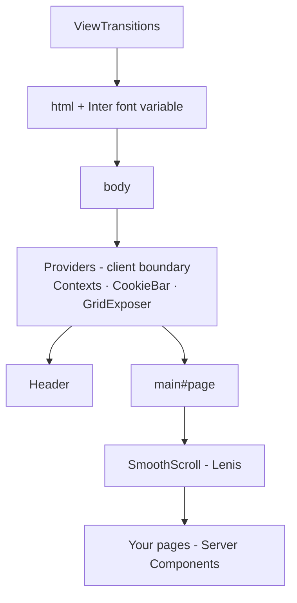

# Joe Ben Taylor — portfolio

The source for [joebentaylor.co.uk](https://joebentaylor.co.uk), built on Tackl with Next.js, SCSS CSS Modules, GSAP, Lenis, and Sanity.


> Full guides live in [`docs/`](./docs) — this README is the map.

## 🚀 Quickstart

Use Bun 1.4.2, as pinned in `package.json` and `netlify.toml`. CI reads the same version from `package.json`. Netlify recreates dependencies from the frozen lockfile on each build to avoid reusing an incompatible nested package from its dependency cache.

```bash
bun install
cp .env.example .env
# Fill in the Sanity values before starting the app.
bun run dev
```

Open [http://localhost:3000](http://localhost:3000). Set your design tokens in `src/theme` (colours, spacing, motion, fonts) and your type styles in `src/css/tackl/_type.scss` — straight from the Figma file.

The site uses Sanity for portfolio content and the embedded Studio at `/studio/`. `.env` is gitignored; `.env.example` is the documented template. See [CMS setup](./docs/CMS.md).

### Scripts

| Command | What it does |
| --- | --- |
| `bun run dev` | Dev server (Turbopack) |
| `bun run build` | Production build (Turbopack) |
| `bun run start` | Serve the production build |
| `bun run type-check` | TypeScript, no emit |
| `bun run lint` / `lint:fix` | Biome (TS/JS/JSON/CSS) + Stylelint (SCSS) check / auto-fix |
| `bun run styles` | Regenerate `tokens.css` + breakpoint/grid SCSS from the TS tokens (runs before dev/build) |
| `bun run format` | Biome format |
| `bun run test` | Playwright specs against the production build |
| `bun run storybook` | Storybook dev on :6006 |
| `bun run build-storybook` | Static Storybook build |
| `bun run lighthouse` | Lighthouse CI (desktop) — Performance 80, Best Practices 90, SEO 100, Agentic Browsing all passing (also runs in CI) |
| `bun run commit` | Optional guided commit-message prompt |
| `git commit` | Husky pre-commit checks generated styles, then runs lint + type-check |

### Editor setup

Open the repo in VS Code or Cursor and accept the recommended extensions (`.vscode/extensions.json`): **Biome** (TS/JS formatting + lint), **Stylelint** (SCSS lint), **CSS Variable Autocomplete** (token autocomplete with colour swatches, read from `tokens.css`) and **SCSS IntelliSense** (completion for `bp()`, the type mixins, `vw()`, `alpha()`). The shared `.vscode/settings.json` wires them up.

### Working with styles

- **Tokens** (colours, spacing, gaps, radii, motion, fonts, breakpoints, grid) live in `src/theme/**` as TS. `bun run dev` / `build` regenerate `src/css/tokens.css` and the breakpoint/grid SCSS from them — never edit the generated files.
- **Type styles** are hand-written mixins in `src/css/tackl/_type.scss`.
- **Components** style themselves from a `styles.module.scss` next to `index.tsx`; the Tackl SCSS layer is injected, so no imports. ➜ [WritingComponents](./docs/Tackl/WritingComponents.md)

## 🎯 What's in the box

- **Next.js 16.4 (App Router)** — server-owned document shell, working `metadata`/`viewport` exports, Turbopack dev *and* prod builds, with Cache Components and Partial Prefetching on by default so routes prerender a static shell, stream the dynamic parts, and share one prefetched App Shell per route instead of one payload per `<Link>`
- **TypeScript everywhere** — strict, with typed design tokens that derive from the values (add a token, the type follows)
- **SCSS CSS Modules, zero runtime** — static, per-route CSS; a globally injected SCSS layer (breakpoint, type and spacing mixins) so modules need no imports; Stylelint catches unknown tokens
- **Tackl theming** — every design token is a CSS custom property on `:root`; runtime theming (dark mode, white-label) is a CSS override, not a re-render
- **Waffl grid** — a 12/6/2-column grid with **zero JavaScript**; plain and server-rendered elements are first-class grid children
- **GSAP + ScrollTrigger + Lenis** — smooth scrolling and scroll animations, pre-wired to share one ticker, with `prefers-reduced-motion` users automatically getting native scroll and no rAF loop
- **View Transitions** — page transitions via the View Transitions API with a typed `Link`/router wrapper
- **Storybook 10** — token-aware (the preview renders the same `:root` variables as the app), with a live `Theme/Overview` story showing every current token — colours, fonts, the type scale with role descriptors, spacing, radii and motion — straight from the theme objects
- **Quality gates that actually run** — Biome + Stylelint + strict TypeScript enforced by the Husky pre-commit hook *and* a GitHub Actions workflow (generated-styles check → lint → type-check → build → Playwright smoke test) that ships with every scaffold; the guided commit-message flow stays available as `bun run commit`
- **Sanity content** — app code imports `fetchContent` and GROQ queries from `@cms`. The embedded Studio at `/studio/` supports draft preview through the Presentation tool.
- **SEO plumbing** — `metadata`/`viewport` exports, `sitemap.xml` and `robots.txt` (staging deploys auto-blocked from indexing), all driven by one `NEXT_PUBLIC_SITE_URL`
- **AI-agent ready (vendor-neutral)** — [`AGENTS.md`](./AGENTS.md) teaches the Tackl conventions to any agent (Cursor, Claude Code, Copilot, Zed, Aider…); [`skills/`](./skills) holds deep-dive Agent Skills; and MCP servers ship pre-configured (`.mcp.json` + `.cursor/mcp.json`) — Next.js devtools plus Chrome DevTools, so agents can inspect builds and drive a real browser against your dev server (screencast tools need `ffmpeg` on PATH)

### Performance posture

The kit ships **~190 KB of gzipped JS** on first load. That budget is spent deliberately: React + Next (~120 KB) and GSAP + ScrollTrigger + Lenis (~45 KB). Everything else is engineered to cost nothing at runtime — styles are static SCSS modules (no styling runtime, no style serialisation during streaming), the grid is pure CSS, the token system is CSS variables (no theme re-renders), `sideEffects` is configured so unused exports tree-shake, fonts load as a single variable-font file, and reduced-motion users skip the animation stack entirely.

## 🧠 Core concepts (5-minute tour)

### 1. SCSS modules, nothing to import

Every component styles itself from a `styles.module.scss` next to it. The Tackl SCSS layer — breakpoint, type and spacing mixins, `vw()`, `alpha()` — is injected into every `.scss` file, so modules start writing immediately:

```tsx
import s from './styles.module.scss';

<section className={s.jacket} data-pad>
	<h1 className='t-displayL'>Heading</h1>
</section>
```

```scss
.jacket {
	background: alpha(--brand-c1, 20);

	@include bp(l) {
		padding-inline: var(--gap-xl);
	}
}
```

Type styles and section spacing are also global: `t-captionL` / `data-type='captionL'`, `data-pad` / `data-mar='top'` — on any element.

➜ [docs/Tackl/WritingComponents.md](./docs/Tackl/WritingComponents.md)

### 2. Tokens are CSS variables

Raw values live once in `src/theme/*`; `bun run styles` generates them onto `:root` in `src/css/tokens.css`; SCSS, plain CSS, Server Components and JS (`theme` from `@theme`) all reference them:

```scss
.card {
	padding: var(--space-m);
	border-color: alpha(--brand-c1, 20);  /* → color-mix(in srgb, var(--brand-c1) 20%, transparent) */
}
```

Dark mode / white-labeling = redefine variables under `html[data-theme='…']`. No JS.

➜ [docs/Tackl/Theming.md](./docs/Tackl/Theming.md)

### 3. The Waffl grid

`Grid` (from `@waffl`) renders a plain `<waffl-grid>` tag — no web component, no client JS. Children span the full grid by default; `Col` opts into columns per breakpoint:

```tsx
import Grid, { Col } from '@waffl';

<Grid $isFixed>
	<Col as='article' $m='2/6' $l='1/7'>Half on desktop</Col>
	<figure>Plain elements work too — full width by default</figure>
</Grid>
```

### 4. Mobile-first breakpoints: `bp()`

Base styles are mobile. `bp(m)`, `bp(l)`, … layer upwards with `min-width` queries — generated from the same breakpoint tokens JS reads (`mq` / `breakpoints` from `@tackl`, e.g. for `gsap.matchMedia`):

```scss
.title {
	font-size: 1.8rem;                       /* mobile default */
	@include bp(m) { font-size: 2.4rem; }    /* ≥ 700px */
	@include bp(l) { font-size: 3.2rem; }    /* ≥ 1024px */
}
```

(`bpd()` exists for the rare max-width case.)

### 5. Motion, responsibly

`SmoothScroll` wires Lenis into GSAP's ticker (one clock for scrolling and ScrollTrigger). Users with `prefers-reduced-motion` skip Lenis entirely — native scroll, no animation loop. Register component animations with `useGSAP` and they clean themselves up.

➜ [docs/Motion.md](./docs/Motion.md) · [docs/GSAP](./docs/GSAP)

## 🏗 Architecture



`app/(site)/layout.tsx` (a Server Component) owns the site's document shell and site-wide `metadata`; `app/(studio)/layout.tsx` is a second, bare root layout for the embedded Sanity Studio. `app/(site)/Providers.tsx` is the only client boundary in the site shell — page content passes through it as `children`, so your pages stay server-rendered.

➜ [docs/Tackl/AppArchitecture.md](./docs/Tackl/AppArchitecture.md)

## 📁 Project structure

    .
    ├── app/                    # Routes (App Router)
    │   ├── (site)/             # The website — its own root layout
    │   │   ├── layout.tsx      # Server shell: html/body, metadata, chrome
    │   │   ├── Providers.tsx   # Client providers (contexts, cookie bar, dev grid)
    │   │   ├── not-found.tsx   # 404 when a page calls notFound()
    │   │   ├── error.tsx       # Error page — keeps the site chrome
    │   │   └── (home)/         # Home route group
    │   ├── (studio)/           # Embedded Sanity Studio at /studio (Sanity scaffolds)
    │   ├── api/draft-mode/     # Draft preview on/off — adapter-agnostic via @cms/draft
    │   ├── sitemap.ts          # /sitemap.xml
    │   ├── robots.ts           # /robots.txt (blocks staging deploys)
    │   ├── llms.txt/           # /llms.txt — a Markdown site map for AI agents
    │   ├── global-not-found.tsx # 404 for URLs that match no route
    │   ├── global-error.tsx    # Last-resort error page (root layout crashed)
    │   └── icon.svg            # Favicon
    ├── src/
    │   ├── cms/                # CMS seam — import from '@cms' only
    │   │   ├── index.ts        # Shared Sanity exports
    │   │   ├── draft.ts        # Sanity draft-mode handler
    │   │   └── sanity/         # Sanity client and GROQ queries
    │   ├── components/         # UI components (one folder each — see WritingComponents.md)
    │   ├── theme/              # Design tokens + the tackl toolkit
    │   │   ├── colors|space|gap|borderRadius|easing|time|fonts|grid/
    │   │   ├── cssVariables/   # toVarRefs / toVarDeclarations helpers
    │   │   └── tackl/          # Col, Waffl Grid, breakpoints/mq, alpha, getVw
    │   ├── css/
    │   │   ├── tackl/          # Injected SCSS layer: bp(), type + spacing mixins, vw(), alpha()
    │   │   ├── utilities/      # Global type (t-*) and spacing (data-pad/mar) utilities
    │   │   ├── tokens.css      # GENERATED :root design tokens
    │   │   └── global.scss     # Layers, reset, grid rules, reduced-motion fallback
    │   ├── config.ts           # siteUrl (drives metadataBase, sitemap, robots)
    │   ├── utils/              # Hooks and helpers
    │   └── types/              # Shared + ambient types (CSS custom props, waffl-grid tag)
    ├── tests/                  # Playwright specs (smoke, consent, 404 + headers)
    ├── sanity/                 # Studio schemas (Sanity scaffolds; config: sanity.config.ts)
    ├── docs/                   # The full documentation set
    ├── skills/                 # Agent Skills (deep-dive SKILL.md playbooks)
    ├── public/                 # Static assets
    ├── tackl/                  # The Tackl CLI (npm: `tackl` + `create-tackl`)
    ├── AGENTS.md               # Vendor-neutral agent instructions
    ├── CLAUDE.md               # Claude Code → imports AGENTS.md
    ├── .env.example            # Documented environment template
├── lighthouserc.js         # Lighthouse CI thresholds (CI fails below them)
    ├── LICENSE                 # MIT
    ├── scripts/build-styles.ts # Generates tokens.css + breakpoint/grid SCSS from src/theme
    ├── biome.json              # Lint + format config (TS/JS/JSON/CSS)
    ├── .stylelintrc.json       # SCSS lint config
    ├── next.config.js          # Images, Sass options, security headers + CSP
    └── tsconfig.json           # Strict TS + path aliases (@tackl, @waffl, @theme, @cms, …)

## 📚 Documentation index

| Guide | What it covers |
| --- | --- |
| [WritingComponents](./docs/Tackl/WritingComponents.md) | File anatomy, comment style, SCSS modules, mixins, grid spans, `bp()` |
| [Theming](./docs/Tackl/Theming.md) | Tokens, CSS variables, opacity, runtime theming |
| [AppArchitecture](./docs/Tackl/AppArchitecture.md) | The app shell, Providers, data flow |
| [WafflGrid](./docs/Tackl/WafflGrid.md) · [GridSystemProps](./docs/Tackl/GridSystemProps.md) | Grid internals and prop reference |
| [SemanticComponents](./docs/Tackl/SemanticComponents.md) | `Col` and the spacing attributes in depth |
| [PageTransitions](./docs/Tackl/PageTransitions.md) | Route transitions with React's `<ViewTransition>` |
| [CookieConsent](./docs/Tackl/CookieConsent.md) | The consent manager, gating scripts by category, analytics |
| [Security](./docs/Tackl/Security.md) | Security headers and the Content-Security-Policy |
| [PerformanceContext](./docs/Tackl/PerformanceContext.md) | Reduced-motion and device signals |
| [Motion](./docs/Motion.md) · [GSAP](./docs/GSAP) | Animation patterns |
| [CMS](./docs/CMS.md) | The `@cms` content layer and Sanity environment |
| [MigratingFromV4](./docs/Tackl/MigratingFromV4.md) | Upgrading a Tackl 4 project from styled-components to SCSS modules |
| [MigratingFromV3](./docs/Tackl/MigratingFromV3.md) | Phased playbook for upgrading a Tackl 3 project |
| [Sanity](./docs/Sanity/README.md) | Setting up the Sanity variant |
| [Lighthouse](./docs/Lighthouse.md) | The Lighthouse CI check and its thresholds |

## ✍️ Committing

Husky's pre-commit hook runs the quality gates (`bun run styles --check` + `bun run lint` + `bun run type-check`) on every `git commit`, and the CI workflow repeats them — plus a production build and the Playwright smoke test — on every push and PR. Want a hand writing the message? `bun run commit` runs the guided prompt: describe the change, pick a type, and it formats a consistent message for you.

## 👥 Authors & Maintainers

Developed and maintained by the 12 Studio team:

- **Joe Taylor** (joe@12.studio)
- **Adam Roberts** (adam@12.studio)

Contributions welcome — check existing GitHub issues first, or reach the team at hello+tackl@12.studio.

### License

[MIT](./LICENSE) © 12 Studio — use it, ship client work with it, no strings beyond the notice.
